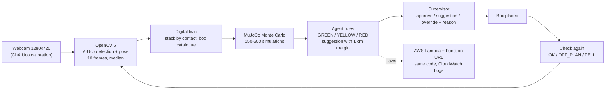

# Drystone

**Predict before you stack.** Drystone watches a stack of boxes with one calibrated camera. OpenCV 5 reads an
ArUco marker on each box, works out where every box sits, and builds a digital twin of the stack. Before the next
box goes on top, a MuJoCo Monte Carlo simulation estimates the chance that the stack falls with the box at the
planned spot. An agent turns that number into an action: guide the placement, ask a supervisor, or reject it and
suggest a safer spot. After the box is placed, the agent looks again and checks that the stack matches the plan.

> **Drystone is a decision-support prototype, not a certified safety device.** It estimates a risk; a person
> always makes the final call. Do not use it to protect people or property.

Why: US OSHA requires stacked materials to be "stable and secure against sliding or collapse", and in US
transportation and warehousing alone there were 99,800 nonfatal cases with days away from work in 2020, of which
12,100 were "struck by object or equipment" (a broader category than falling stacks); see the sources in
[docs/REPORT.md](docs/REPORT.md).

Built for the OpenCV AI Competition 2026.

## Live demo for judges
The link to the live page is on our Devpost submission page. The page runs on AWS Lambda (ap-southeast-1) with
the same code as the laptop agent.

1. **Pick a sample photo.** Three real photos from our calibrated webcam: one box, two boxes aligned, two boxes
   with the top one shifted. The page draws the detected markers and the digital twin on the photo.
2. **Pick a spot with the slider** (−16 to +16 cm), or tap one of the example chips: a GREEN, a YELLOW and a RED
   case and the suggested spot, to the left and to the right. *Shift* = how far the next box sits from the box
   directly below it, in whole cm (− left, + right). While you pick, the photo shows the next box as a dashed
   outline, "not checked yet"; nothing is computed until you press **Check +X cm** (or Enter).
3. **Read the decision:** zone, P(fall) with its uncertainty and number of simulations, the
   agent's action, a suggested spot when the request is not green, and a numbered trace (marker detection →
   digital twin → simulation → decision → action) with the time of each step.
4. **Use suggestion** (YELLOW or RED) moves the box to the suggested spot and checks it again; it comes back GREEN.
5. **Override** (RED) needs a name and a reason. It is written to the server log and never changes the result.

The first request after a quiet period starts the server and can take about 10 seconds. There is no photo upload:
the service is calibrated for one camera (our laptop webcam, 1280×720).

## How it works


The agent loop, with its failure branches, is in [docs/img/agent_loop.png](docs/img/agent_loop.png) and in the
[technical report](docs/REPORT.md). Text version of the architecture (Mermaid):



- **Camera and OpenCV 5.** The webcam is calibrated with a ChArUco board (`tools/calibrate.py`). Each box carries
  an 80 mm ArUco marker (DICT_4X4_50) in the middle of its front face. The agent reads 10 frames, solves each
  marker's pose, averages the facing direction of the stacked markers and takes the median position of each box.
- **Digital twin.** The stack is built from the bottom box (ID 0) up by physical contact: the next box must rest
  on the top of the one below and overlap it. A box on the floor next to the stack is not part of the stack.
  Box sizes and weights come from `config/boxes.json` (measured with a ruler).
- **Simulation.** MuJoCo drops the candidate box on the twin many times, with 1 cm position and 2 cm load-centre
  uncertainty. P(fall) is the share of runs in which a box falls. Near a zone line the agent doubles the runs
  (up to 600); if it is still unsure, it takes the safer zone.
- **Agent rules** (deterministic code in `tools/drystone_core.py`, no language model):

  | P(fall) | Zone | Action |
  |---|---|---|
  | under 10% | GREEN | GUIDE: show where to place the box |
  | 10–50% | YELLOW | ASK_SUPERVISOR: approve / use suggestion / reject |
  | over 50% | RED | REJECT and suggest the nearest safe spot; going on needs an override with a name and a reason |

  A suggested spot must be GREEN in 150 simulations **and** the spot 1 cm further out must be GREEN too, so the
  suggestion stays green even if the box lands 1 cm further out.
- **Check after placement.** OK, OFF_PLAN (placed more than 1.5 cm from the plan; the risk is computed again),
  or FELL (the box is on the floor or gone). If the box is not visible at all while the stack below is intact,
  the agent asks the supervisor at the terminal: *f = it fell out of view, p = not placed yet*.
- **AWS.** `tools/service.py` runs as a container image on AWS Lambda behind one Function URL: the judges' page,
  the sample photos, decisions for the samples, the supervisor log (one JSON line per choice in CloudWatch Logs),
  and the photo API used by `agent.py --aws`. If AWS fails, the laptop computes the decision and logs it.

## The agentic loop: one real run
From our final practice with real boxes on 18 Oct (`agent.py --aws`, decisions on Lambda). Box ID 1 already
stands on box ID 0; the worker asks for box ID 2 at +18 cm:

```
computed on AWS Lambda (10.0 s round trip, 7.1 s on the server)
digital twin: 2 box(es) + candidate ID 2 overhanging +62% (+18.0 cm)
static check: falls (centre-of-mass margin -3.5 cm)
150 simulations: P(fall) = 93% +- 4%
not green -> searching the nearest safe position
try +12 cm (+41%): P = 15%
try +11 cm (+38%): P = 12%
try +10 cm (+34%): P = 4%, but 1 cm further out (+11 cm P = 12%) is not green -> no margin, keep looking
try +9 cm (+31%): P = 1%; 1 cm further out (+10 cm P = 4%) also green -> suggestion
```

What happened next, all driven by what the camera saw:
1. RED → REJECT. The supervisor overrode it on purpose (name and reason logged). The box fell.
2. The check saw box ID 2 on the floor next to the stack: **FELL**. The agent asked for it to be picked up and
   planned it again, instead of moving on.
3. The new decision was RED again with the same suggestion. The supervisor chose the suggestion (+9 cm).
4. The check found the box 0.3 cm from the plan: **OK**, stack P(fall) 1%, GREEN.

## Results so far
| What | Result |
|---|---|
| Camera calibration (laptop webcam, 1280×720) | 61 views, RMS reprojection error 0.37 px, focal length 900.0 ± 3.9 px (0.43%), 12/12 image regions covered |
| Test 1: box position from one marker | random error RMS 0.18 cm (max 0.47 cm), rotation ≤ 2.2°; an unexplained scale bias of about ±3% |
| Test 2: prediction vs reality, first settings (position 0.5 cm, load 1 cm) | 12 trials with 2–3 real boxes, 20–65% overhang, 11 counted: 9/11 correct (82%), Brier score 0.177, **1 fall in the GREEN zone** (both wrong predictions on the dangerous side, close to the edge) |
| Test 2, current settings (position 1 cm, load 2 cm), recomputed on the same trials | 9/11 correct (82%), Brier score 0.145, **0 falls in the GREEN zone**. Tuned on the same trials, so it must be confirmed on new trials (below) |
| Practice with real boxes, 18 Oct (3 sessions, `--aws`) | 7 RED placements forced by override (P(fall) 86–98%): **7/7 fell, 7/7 detected as FELL**. Real placements landed 0.0–1.3 cm from the plan. RED decisions on Lambda 8.5–10.4 s round trip; checks 2.9–6.9 s |
| Final scene, 18 Oct | GREEN → RED 93% → override → fell → FELL → re-planned → suggestion +9 cm → OK (−0.3 cm), stack GREEN 1% |

**Evaluation on 25 new trials (18 Oct), protocol locked before the data: FAIL on one of five criteria.**

| Locked criterion | Result | Target | |
|---|---|---|---|
| C1 falls in the GREEN zone | 0 of 8 GREEN trials | 0 | PASS |
| C2a accuracy on clear trials (P < 10% or > 70%) | 14/14 (100%) | ≥ 85% | PASS |
| C2b total falls inside the 90% interval of the predicted number | 12 falls; predicted 8.5, interval 6–11 | inside | **FAIL** |
| C3 Brier score | 0.125 | ≤ 0.20 | PASS |
| C4 trials with an outcome | 25/25 | ≥ 20 | PASS |

GREEN stayed safe (0/8 fell) and every RED trial fell (8/8), but YELLOW trials fell 4 times out of 9 against a
mean predicted P of 25%: the model is too optimistic close to the edge. Overall accuracy (not a criterion) 84%,
against 82% in Test 2. Falls detected as FELL: 12/12 in the evaluation (7/7 in practice). Decisions on AWS Lambda:
median 7.6 s; placement error of boxes that stood: median 0.6 cm.
Details, failure cases and a post-hoc analysis (not used by the system): [docs/REPORT.md](docs/REPORT.md),
per-trial data: [data/eval_report/trials.csv](data/eval_report/trials.csv).

## Run it yourself
Python 3.12, one command per line. Where Windows (cmd) and macOS/Linux differ, both are shown. Each command was run
in a fresh clone on Windows cmd.

Before you start: Git, and Python 3.12 (on Windows, `py -3.12` needs Python 3.12 installed from
[python.org](https://www.python.org/downloads/)). For your own AWS Lambda also Docker Desktop (running) and AWS CLI v2;
the first-time AWS steps, including `aws configure` and the function name `drystone`, are in
[aws/README.md](aws/README.md#first-time-setup-already-done-for-this-project).

Get the code and install (`requirements-dev.txt` includes `requirements.txt` and adds pytest):
```
git clone https://github.com/yasinfitrah24-tech/drystone.git
```
```
cd drystone
```
Windows (cmd):
```
py -3.12 -m venv .venv
```
```
.venv\Scripts\activate
```
macOS / Linux:
```
python3.12 -m venv .venv
```
```
source .venv/bin/activate
```
Then, on any system:
```
pip install -r requirements-dev.txt
```

Run the judges' page locally (same handler as Lambda), then open http://127.0.0.1:8000/ (the address it prints;
another port: `--port 8080`):
```
python tools/web_local.py
```

Print the sheets at 100% (actual size, not "fit to page"): [`docs/print/markers_A4.pdf`](docs/print/markers_A4.pdf)
(box markers ID 0–2, ArUco DICT_4X4_50, 80 mm, with a 100 mm ruler to check the scale) and
[`docs/print/charuco_A4.pdf`](docs/print/charuco_A4.pdf) (ChArUco 7×5 calibration board, 30 mm squares, 22 mm
markers, DICT_5X5_100, A4 landscape). Both are made by `python tools/make_print_sheets.py` from the settings in
`tools/common.py`. Measure what you printed.

Calibrate your camera: glue the ChArUco board to a flat hard board and measure one printed square. Match the board to the blue outline on screen; it saves by itself and moves to the next one. About 14 targets. Then the verdict is PASS or RETRY.
PASS needs an RMS error of 1 px or less, a focal length uncertainty of 3% or less, and 9 of 12 image regions covered.
PASS saves `data/camera_mycam.yaml`; on RETRY the terminal says what to fix. `data/camera_laptop.yaml` is our own
webcam; calibrate yours.
```
python tools/calibrate.py --name mycam --square-mm 30
```
Replace 30 with the square you measured (ours: 29.8). Keys in the calibration window: N skip target · B back one target · C calibrate now · Q quit.
For a clean reading: print on matte paper, tape it flat to something hard, light the board from the side (a lamp behind the camera shines back off a tilted board), and keep your fingers off the squares. The hints speak to you behind the board: "pull the top edge toward you" means that edge goes away from the camera. If one target will not match, N skips it.
Without the outlines: add `--auto` (a frame is saved whenever the board is held still at a new position).

Run the agent on the laptop (boxes listed in `config/boxes.json`, 80 mm markers):
```
python tools/agent.py --calib data/camera_mycam.yaml --marker-mm 80
```
Keys in the agent window: A / D move candidate 1 cm · SPACE decide / check · X cancel · Q quit.

Optional, only after you have deployed your own Lambda (first-time steps in `aws/README.md`): run the agent with
decisions on that Lambda. The laptop keeps the camera and the window; each decision is computed on your Lambda, and if AWS fails the laptop computes it itself.
The Lambda image uses the calibration in `data/camera_laptop.yaml`, so put yours in that file before you build it.
Windows (cmd):
```
for /f %i in ('aws lambda get-function-url-config --function-name drystone --region ap-southeast-1 --query FunctionUrl --output text') do set DRYSTONE_URL=%i
```
```
python tools/agent.py --calib data/camera_mycam.yaml --marker-mm 80 --aws %DRYSTONE_URL%
```
macOS / Linux:
```
export DRYSTONE_URL=$(aws lambda get-function-url-config --function-name drystone --region ap-southeast-1 --query FunctionUrl --output text)
```
```
python tools/agent.py --calib data/camera_mycam.yaml --marker-mm 80 --aws "$DRYSTONE_URL"
```

Run the tests (web endpoint, check after placement, the whole agent loop with a fake camera):
```
python -m pytest tests -q
```

Rebuild the evaluation summary from the published per-trial table; it writes
`data/eval_report/from_trials/summary.md`, which matches `data/eval_report/summary.md` except its first line:
```
python tools/eval_report.py --trials data/eval_report/trials.csv
```
Our agent logs stay on our laptop (their photos show people). With an evaluation log of your own
(`agent.py --eval-plan`, see `docs/EVAL_PROTOCOL.md`), `--logs <path to log.jsonl>` writes both `trials.csv` and
`summary.md`.

## Limitations and responsible use
- **Markers are required.** Every box needs a printed ArUco marker in the middle of its front face. Faded markers
  in dim light can be missed; the agent then asks *f / p* instead of guessing. Reprint faded markers and record in
  good light.
- **One calibration per camera and resolution.** The Lambda service is calibrated for our webcam at 1280×720.
  Another camera needs its own calibration.
- **Uniform boxes.** The catalogue has three measured boxes of the same type (29 × 17 × 19.4–19.6 cm, 1.0 kg,
  load in the middle). Other boxes, uneven loads or soft boxes are outside what we tested.
- **Measurement limits.** Test 1 showed a scale bias of about ±3% that we have not explained. Uncertainty
  settings were tuned on Test 2 and then tested on 25 new trials with locked criteria (see Results).
- **Under-prediction near the edge.** In the evaluation, trials with a centre-of-mass margin of +0.5 to +2.5 cm
  fell 4 times out of 8 while the model predicted 12–43%. Treat YELLOW as more dangerous than its number says.
- **Small samples.** Test 2 has 11 counted trials and the evaluation 25; the practice runs are demonstrations.
- **Public endpoint and cost.** The Function URL is public and the AWS account is a paid account: it does not
  close by itself (the endpoint stays up through judging, until 10 Nov), and usage above the always-free quota
  (Lambda: 1 million requests and 400,000 GB-seconds a month; CloudWatch Logs: 5 GB) is billed. A zero-spend budget
  alarm sends an email at the first cent. Requests are limited per IP and per container (60 GET and 20 POST a
  minute), and the judges' page answers from a cache of at most 99 decisions per container, so repeated page use
  costs almost nothing. The worst case is someone keeping all 10 concurrent executions busy (the account limit;
  reserved concurrency cannot be set below it) with new photos: 10 × 2 GB × 3,600 s = 72,000 GB-seconds an hour,
  about **USD 1.20 an hour** at the Lambda list price (USD 0.0000166667 per GB-second, x86, ap-southeast-1); the
  monthly free quota covers about 5.5 hours of that.
- **Decision support only.** The agent never moves a box. A person places every box, can override a rejection
  (logged with name and reason), and remains responsible.

## Repository
- `tools/`: `calibrate.py` (ChArUco calibration), `pose_test.py` (Test 1), `predict_test.py` (Test 2),
  `make_eval_plan.py` + `eval_report.py` (evaluation), `posthoc_sim_settings.py` (post-hoc analysis, not used by the
  system),
  `drystone_core.py` (decision rules and simulation), `agent.py` (live agent), `service.py` (Lambda handler and
  the judges' page API), `web_local.py` (local server), `capture_sample.py` (sample photos),
  `make_placeholder_samples.py` (synthetic renders used by the tests), `ghost_boxes.py` (the judges' page's
  "not checked yet" outline of the next box, from the same projection as the service), `common.py`
- `web/`: the judges' page (`index.html`) and sample photos (`samples/`)
- `aws/`: Dockerfile, Lambda requirements, deployment notes, endpoint test
- `config/boxes.json`: box catalogue by marker ID
- `data/`: camera calibration and test results (CSV); raw photos and agent logs are not published (they show
  people and rooms)
- `tests/`: pytest suite with synthetic camera photos
- `docs/`: project status and hand-off notes (Indonesian)

## License
MIT, see [LICENSE](LICENSE). OpenCV and MuJoCo are Apache 2.0, NumPy is BSD 3-Clause.
