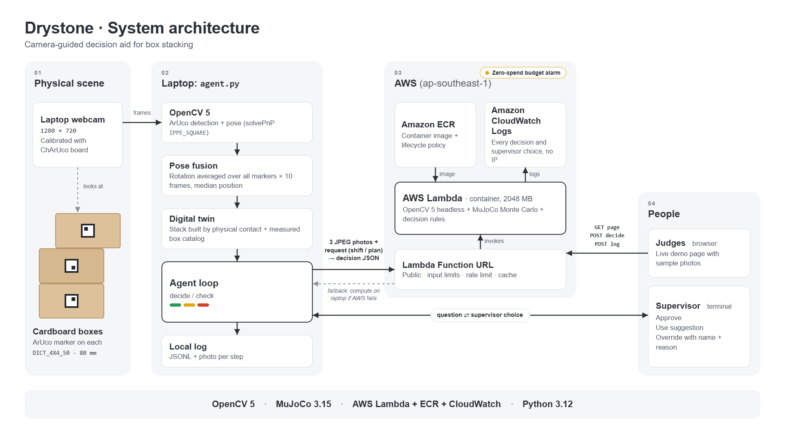
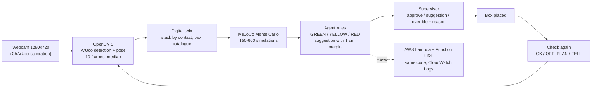
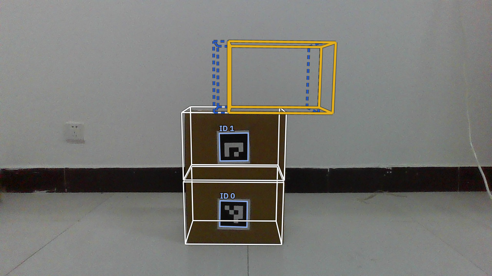
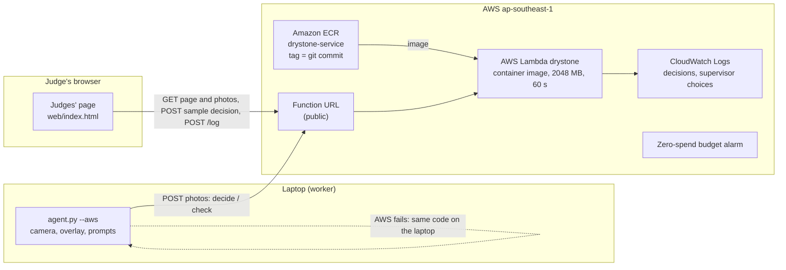
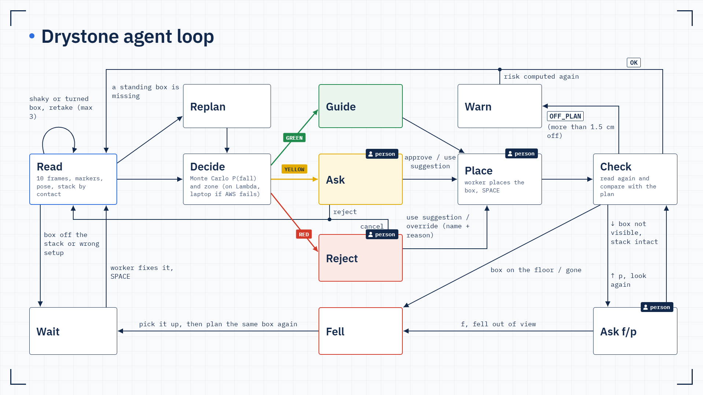
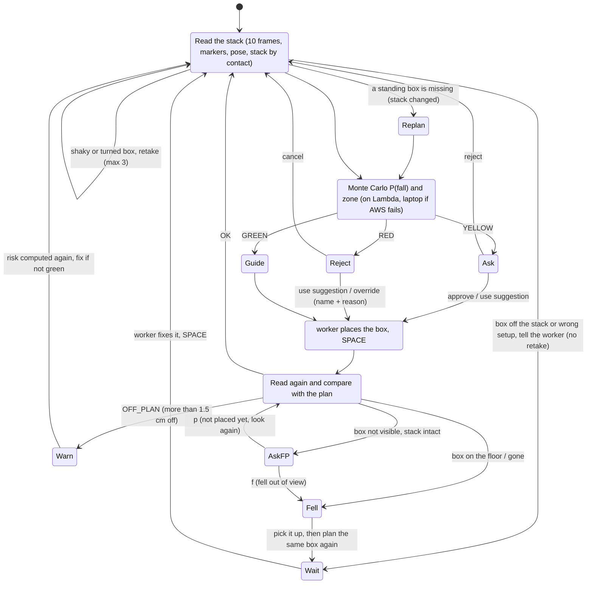
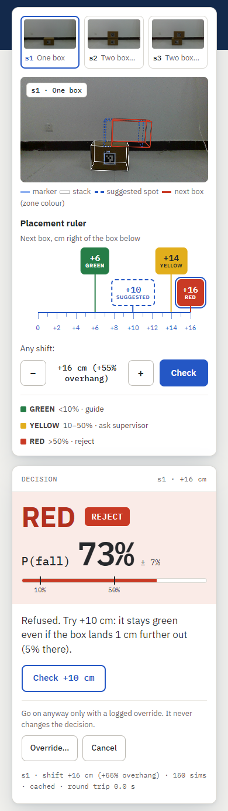

# Drystone: technical report

*Predict before you stack.* OpenCV AI Competition 2026. Report of 23 Oct 2026, with the evaluation on new trials
(section 7.4).

**Where the numbers come from.** Project log `docs/STATUS.md`; evaluation output `data/eval_report/summary.md` and
`data/eval_report/trials.csv` (made by `tools/eval_report.py` from the evaluation log); the agent logs
(`data/agent_*/log.jsonl`) stay on the laptop because their photos show people and rooms, and the figures taken from
them are summarised in `docs/STATUS.md`; the post-hoc table in section 7.4 is reproduced by
`tools/posthoc_sim_settings.py` (post-hoc analysis, not used by the system).

> Drystone is a **decision-support prototype, not a certified safety device**. It estimates a risk; a person makes
> every decision and places every box.

## Summary
- **What it is.** One calibrated webcam and OpenCV 5 read an ArUco marker on each box and build a digital twin of
  the stack; a MuJoCo Monte Carlo simulation estimates P(fall) for the next box; fixed rules turn it into GREEN
  (guide), YELLOW (ask a supervisor) or RED (reject and suggest a safer spot), and the camera checks the result.
- **Evaluation verdict: FAIL** under the criteria locked before the data, on C2b by one fall: 12 falls against an
  interval of 6–11.
- **The other four criteria passed:** C1 0 of 8 GREEN trials fell, C2a 14/14 correct on clear trials, C3 Brier
  0.125, C4 25 of 25 trials with an outcome. Overall accuracy (not a criterion): 84% (21/25).
- **The agent:** falls detected as FELL in 12/12 evaluation trials; decisions on AWS Lambda took a median of
  7.6 s.
- **Where it fails, and the full numbers:** [section 7.4](#74-evaluation-on-new-trials-18-oct-fail-on-c2b-by-one-fall).

## 1. Problem and real-world use
Stacking boxes by hand is a judgement call: how far can the next box hang over the one below before the stack
falls? Without a tool, that call is usually made by eye: positions, overhang and load are rarely measured before
the next box goes on. A wrong call drops a box on the floor, or on someone's foot.

Drystone measures and predicts *before* the box is placed. One calibrated camera reads where each box is, a
physics simulation estimates the chance that the stack falls with the next box at the planned spot, and an agent
turns that number into an action and checks the result afterwards.

Where it fits: places that stack cartons by hand without racking or a stacking plan, such as a small warehouse, a
shop's stock room, or a house move. What it needs: a laptop with a webcam (ours: the built-in webcam at 1280×720,
calibrated once), an 80 mm ArUco marker printed and stuck on each box, and a catalogue of the box sizes and weights.
AWS is optional: it adds a shared, logged decision service and the judges' page; without it the laptop computes
everything. A decision took a median of **7.6 s** on AWS Lambda in the evaluation (section 7.4).

**Why it matters.**
- *Scale of the problem.* In US transportation and warehousing in 2020, the Bureau of Labor Statistics counted
  **99,800** nonfatal cases with days away from work, of which **12,100** were "struck by object or equipment",
  and **65** fatal injuries from "contact with objects and equipment" (62–75 a year in 2016–2020) [1]. These
  figures combine transportation with warehousing, and the categories are much broader than stacks that fall:
  they show the scale of the problem, **not** how many people are hurt by falling stacks of boxes.
- *What the rules ask for.* US OSHA requires materials stored in tiers to be stacked, blocked, interlocked and
  limited in height so that they are "stable and secure against sliding or collapse" [2].
- *What it looks like.* Oregon OSHA (November 2025) reports a 39-year-old worker killed when two stacks of lumber
  fell on him (initial penalties USD 43,401), and a retail case where boxes stacked more than 7 feet high collapsed
  and trapped an employee at the waist [3].

Drystone is a low-cost decision aid for this: a webcam and printed markers that estimate the risk **before** the
box is placed. It is a prototype, **not a certified safety device**, and it was tested only on three uniform
cardboard boxes of 1.0 kg, not on real warehouse loads such as lumber or full cartons stacked above head height.

## 2. Users
- **The worker** who stacks the boxes: sees on screen where the next box can go, and is told when it should not.
- **The supervisor** who is accountable for risky placements: approves borderline ones, and can override a
  rejection only with a name and a reason, which is logged.
- **Whoever reviews incidents later**: every decision, approval, override and check is in a log with the photo.

## 3. What is new
- **A measured digital twin, per placement.** The camera reads the real positions of the boxes (not a plan) and the
  physics is run for *this* stack and *this* next box, before it is placed.
- **Risk with its uncertainty, not a yes/no.** Monte Carlo over position and load-centre uncertainty gives P(fall)
  with an interval; near a zone line the agent runs more simulations and, if still unsure, takes the safer zone.
- **Graded actions.** P(fall) drives three different behaviours: GUIDE, ASK_SUPERVISOR, REJECT; a rejection comes
  with the nearest safe spot that also stays safe if the box lands 1 cm further out.
- **A closed loop.** After the box is placed, the camera checks the result (OK, OFF_PLAN, FELL) and the agent
  re-plans: a fallen box is planned again, a changed stack is noticed.

**Honest baseline.** A static check alone (predict a fall when the centre of mass is past the edge) scores the same
accuracy as the simulation on the 25 evaluation trials: **21/25 (84%) both**. The simulation is better calibrated:
**Brier 0.125 against 0.160** for the static yes/no. What the simulation adds is a graded probability with its
uncertainty, which is what the agent needs to choose between GUIDE, ASK and REJECT and to search for a suggestion
with a margin; a yes/no cannot tell a borderline placement from a safe one.

## 4. Architecture



Text version of the figure (Mermaid):



| Part | Where | What it does |
|---|---|---|
| Perception | `tools/agent.py` (`read_scene`, `build_stack`) | markers → box poses → the stack, by contact |
| Decision core | `tools/drystone_core.py` | static check, Monte Carlo P(fall), zones, suggestion search, check after placement |
| Live agent | `tools/agent.py` | camera loop, wireframes, human control, JSONL log with photos |
| Service | `tools/service.py` | AWS Lambda handler: photo API for the agent, judges' web page and its API |
| Web page | `web/index.html` | sample photos, placement slider with a preview of the next box, decision, numbered trace, use suggestion, override |

All decision rules live in one file, `drystone_core.py`. The laptop agent and the Lambda service call the same
code; no rule is written twice, and no language model decides anything.

## 5. OpenCV 5 implementation
- **Calibration.** ChArUco board 7×5 (DICT_5X5_100), printed with 30 mm squares that **measured 29.8 mm**, glued to a
  flat board; automatic capture rejects duplicate views. The laptop webcam: **61 views, RMS reprojection error 0.37
  px, focal length 900.0 ± 3.9 px (0.43%), 12/12 image regions covered** (`data/camera_laptop.yaml`). A calibration
  is used only if it passes a quality check (verdict PASS: RMS ≤ 1 px, focal uncertainty ≤ 3%, ≥ 9/12 regions, ≥ 10
  views; otherwise RETRY, saved as a draft). The focal limit was 1% until 24 Oct; hand-held printed boards ended at
  2.5% with a clean RMS. A focal length 5% off moves the boxes relative to the bottom box by under 1 mm (only the
  camera distance changes, since depth and size scale together), so 3% costs the decisions nothing (`tests/test_focal_error.py`). A first
  attempt with a hand-held paper board gave 1.18 px and a focal length off by ±75 px; it was rejected.
- **Markers and pose.** An 80 mm ArUco marker (DICT_4X4_50) in the middle of each box's front face, detected with
  sub-pixel corner refinement; pose with `solvePnPGeneric` (IPPE square), and the ambiguous flat-marker solution
  resolved toward the base box orientation.
- **Steady positions.** One marker's facing direction wobbles by a few degrees from frame to frame; pushing the
  marker centre back along that direction made box positions jump by **1.5–3.6 cm**. Drystone averages the facing
  direction of all stacked markers over 10 frames (chordal mean of rotations) and takes the median position of each
  box: the jitter fell to **±0.1 cm** in a synthetic test. Test 1 (one marker): random error RMS **0.18 cm** (max
  0.47 cm), rotation ≤ 2.2°.
- **The stack by contact.** The stack is built from the bottom box up: the next box must rest on the top of the
  one below (within 4 cm) and overlap it. Other visible boxes are "off the stack" (floor, beside, or in the air).
  The facing direction comes from the stacked markers only: before this, one box that fell and lay turned 50° on
  the floor tilted the whole stack frame by **16°**.
- **Rejected change.** A lower adaptive threshold (`adaptiveThreshConstant` 7 → 3) read one faded marker that the
  default missed (148 real photos: 341 vs 340 markers, 0 false detections), but moved marker corners by up to
  **6.4 px** onto the white paper in darker photos and box positions by up to **61 mm** in 44 readings. It was
  rejected; missed markers are handled by asking the supervisor instead (sections 8.4 and 8.6).



*Sample s2 (two boxes, aligned) with the next box planned at +13 cm, as drawn by the judges' page. Light blue:
the detected ArUco markers with their IDs. White: the digital twin of the stack (boxes ID 0 and ID 1). Solid
yellow: the planned next box, in its zone colour (YELLOW, P(fall) 27%). Dashed blue: the suggested spot,
+9 cm, which stays green even if the box lands 1 cm further out.*

## 6. AWS deployment



- **AWS Lambda, container image** (OpenCV 5 + MuJoCo + NumPy are too large for a zip), x86_64, 2048 MB, 60 s
  timeout, region ap-southeast-1, image in Amazon ECR. One **Function URL** serves the photo API for
  `agent.py --aws` (decide / check), the judges' page and sample photos, decisions for the samples, and the
  supervisor log (one JSON line per choice in **CloudWatch Logs**, without the IP address).
- **Same code on both sides.** If AWS fails, the laptop computes the decision with the same code and logs that it
  did.
- **Deploys** are tagged with the git commit hash; the live version and the rollback target are written in
  `docs/STATUS.md` before each deploy (the live tag is listed there). An ECR lifecycle policy keeps the two
  newest tagged images and removes untagged images after 14 days, so the rollback target is always the previous
  version.
- **Speed.** Stopping each simulation as soon as a box falls or every box is at rest gave identical results on
  1,500 samples and about 2.9× less time; a YELLOW case on Lambda went from 16.3 s to 3.8–5.6 s. In the 18 Oct
  practice: RED decisions **8.5–10.4 s** round trip from the laptop (China → Singapore), checks **2.9–6.9 s**; in the
  evaluation: median **7.6 s**, max 11.1 s (section 7.4).

**Security and responsible operation.**
- The Function URL is **public on purpose, without authentication**, so judges can open the page. It is not written
  in the repository; it is given on the submission page.
- Inputs are bounded: web JSON ≤ 16 KB, photo POST ≤ 2 MB (else 413); 60 GET and 20 POST per minute per IP and per
  container (else 429); the shift is rounded to 1 cm in −16…+16 cm; there is no photo upload on the page, and the
  sample photos come from a fixed list.
- Decisions for the samples are cached (at most 99 per container), so repeated page use costs almost nothing.
- No secret is in the repository (access keys only in the local `aws configure`); a scan of every tracked file and
  of the whole git history found no access key, no account number and no Function URL.
- Supervisor choices are logged without the IP address; upstream error details stay in CloudWatch and the browser
  gets a short message.
- Cost: the account is a paid account; a zero-spend budget alarm sends an email at the first cent. Reserved
  concurrency cannot be set (account limit 10); the worst case (10 busy executions × 2 GB) is about USD 1.20 an hour
  at the Lambda list price.

## 7. Evaluation
### 7.1 Perception
Calibration and Test 1: section 5.

### 7.2 Test 2: prediction vs reality (17 Oct)
12 trials with 2–3 real boxes and 20–65% overhang, 11 counted.

| Uncertainty settings | Correct | Brier | Falls in GREEN |
|---|---|---|---|
| position 0.5 cm, load 1 cm (first) | 9/11 (82%) | 0.177 | **1** |
| position 1 cm, load 2 cm (current, recomputed on the same trials) | 9/11 (82%) | 0.145 | **0** |

Both wrong predictions were on the dangerous side and close to the edge (centre-of-mass margins 1.3 and 2.5 cm),
which is why the uncertainty was raised. The current settings were tuned on these same trials, so they had to be
confirmed on new trials (7.4). Test 2 also used the older perception (section 5).

With the measured box heights (19.4–19.6 cm instead of 19 cm) Test 2 and the sample zones are unchanged; a
control test showed height barely moves P(fall) (19 → 40 cm: 26.7% → 28.0% at +13 cm). What decides is where the
centre of mass sits relative to the edge below.

### 7.3 Practice with real boxes (18 Oct, `agent.py --aws`)
- 7 RED placements forced by override (P(fall) 86–98%): **7/7 fell, 7/7 detected as FELL**.
- Real placements landed **0.0–1.3 cm** from the plan. A suggestion right at the 10% line (+9 cm, P 5%) placed
  1.3 cm out turned the stack YELLOW 18%; this led to the 1 cm margin rule (section 8.2).
- Final scene: GREEN → RED 93% → override → fell → FELL → re-planned → suggestion +9 cm → OK (−0.3 cm), stack
  GREEN 1%.

### 7.4 Evaluation on new trials (18 Oct): FAIL on C2b by one fall
Protocol `docs/EVAL_PROTOCOL.md`, locked before any data (commit `8a953e4`): 25 pre-set trials in a shuffled order,
settings frozen, outcome confirmed by the worker. All 25 trials ran in one session (18 Oct, 15:26–15:53, 26 minutes,
`agent.py --aws`); the protocol records this and two other administrative corrections (title date, session date).
Trial list, settings, criteria and code did not change after the lock (sha256 of the trial list unchanged, no diff
in `tools/`, `tests/`, `config/`). Per-trial data: `data/eval_report/trials.csv`; summary: `data/eval_report/summary.md`.

| Criterion (locked) | Result | Target | |
|---|---|---|---|
| C1 falls in the GREEN zone | **0 of 8** GREEN trials | 0 | PASS |
| C2a accuracy on clear trials (P < 10% or > 70%) | **14/14 (100%)** | ≥ 85% | PASS |
| C2b total falls inside the 90% interval of the predicted number | **12 falls**; Σp = 8.537, sd 1.772, interval 5.62–11.45 → 6–11 | inside | **FAIL** |
| C3 Brier score | **0.125** | ≤ 0.20 | PASS |
| C4 trials with an outcome | **25 of 25** | ≥ 20 | PASS |

**Verdict: FAIL** under the locked criteria, because of C2b: one fall more than the upper end of the interval
(z = 1.96). A calibrated model with these P would see 12 or more falls only 4.7% of the time, so this is a real
signal, not bad luck: **the model under-predicts falls.** Overall accuracy (P ≥ 50% predicts a fall), which is not a
criterion, was **84% (21/25)**, against 82% in Test 2.

| Zone | Trials | Falls | Fall rate | Mean P(fall) |
|---|---|---|---|---|
| GREEN | 8 | 0 | 0% | 3% |
| YELLOW | 9 | 4 | 44% | 25% |
| RED | 8 | 8 | 100% | 75% |

| P(fall) range | Trials | Mean predicted | Observed fall rate |
|---|---|---|---|
| 0–10% | 9 | 4% | 0% |
| 10–30% | 5 | 20% | 40% |
| 30–50% | 3 | 39% | 67% |
| 50–70% | 3 | 60% | 100% |
| 70–90% | 3 | 80% | 100% |
| 90–100% | 2 | 92% | 100% |

Operations: placement error of the boxes that stood: mean 0.6 cm, median 0.6 cm, max 1.7 cm (10/13 within 1 cm;
T06 was 1.7 cm off and stood). Decisions on AWS Lambda: median 7.6 s, max 11.1 s round trip, 25/25 on AWS. Retakes
0, f/p questions 0, laptop fallbacks 0, outcomes corrected by the worker 0. The agent refused to decide 4 times
because the setup was wrong (T03: ID 1 at +10 cm instead of +5 cm, twice; T09: ID 1 not placed yet, twice).

#### Failure cases
The protocol requires every GREEN fall (none), every wrong prediction and every corrected outcome (none). The four
wrong predictions are all **YELLOW trials that fell**:

| Trial | Stack | Shift | Centre-of-mass margin | P(fall) | Outcome |
|---|---|---|---|---|---|
| T16 | 3 boxes, ID 1 at −4.6 cm | +12 cm | +2.5 cm | 14% | fell |
| T17 | 3 boxes, ID 1 at −0.2 cm | −12 cm | +2.5 cm | 17% | fell |
| T01 | 2 boxes | +14 cm | +0.5 cm | 35% | fell |
| T25 | 3 boxes, ID 1 at +5.2 cm | +14 cm | +0.5 cm | 43% | fell |

The RED trials closest to the line (T18 62%, T20 58%, T21 60%; margin −0.5 cm) all fell: the predictions were
right, but the model under-estimated the fall risk there too (about 60% predicted, 3 of 3 fell).

Ordered by the static centre-of-mass margin, the picture is clear: every trial with a margin of −0.5 cm or less fell
(8/8, all predicted RED), every trial with +3.5 cm or more stood (9/9, all GREEN or 9%), and in between, from +0.5
to +2.5 cm, **4 of 8 fell** while the model predicted 12–43%. The model ranks the risk correctly and keeps GREEN
safe, but it is **too optimistic in the middle band**. In that band 3 of the 4 three-box trials fell (T16, T17, T25;
T07 stood) against 1 of 4 two-box trials (T01; T04, T13, T15 stood); with 8 trials this is a hint, not a finding.

Possible causes (hypotheses, not conclusions):
- **Friction** in the simulation (0.5) may not match these boxes and this floor (the post-hoc check below does not
  support "too high").
- **Load and centre of mass**: the 2 cm uncertainty of the load centre may be too small (contents shift; the box
  flaps add weight near the top).
- **The floor**: smooth tiles; the base box can slide or rock, which the simulation treats as fixed ground with the
  same friction.
- **How the box is released**: a small push or tilt when letting go matters most near the edge, and more for a box
  released 40 cm up (three-box trials) than 20 cm up.
- **Box compliance**: cardboard edges bend under an overhanging box; the simulation uses rigid boxes.

#### Post-hoc analysis (not used by the system)
**Post-hoc, not used by the system, nothing deployed.** P(fall) recomputed on the 25 stacks recorded in the log with
other simulation settings (the locked settings reproduce the logged P exactly, max difference 0.000). Reproduce with
`python tools/posthoc_sim_settings.py --log data/agent_20261018_152640/log.jsonl`.

| Position sd | Load-centre sd | Friction | Brier | Log-likelihood | Σp (90% interval) |
|---|---|---|---|---|---|
| **1 cm** | **2 cm** | **0.5 (locked)** | 0.125 | −9.61 | 8.54 (5.6–11.5) |
| 1 cm | 3 cm | 0.5 | 0.126 | −9.96 | 9.23 (5.9–12.6) |
| 1 cm | 4 cm | 0.5 | 0.132 | −10.69 | 10.42 (6.8–14.1) |
| 1.5 cm | 2 cm | 0.5 | 0.124 | −9.64 | 8.79 (5.7–11.9) |
| 2 cm | 2 cm | 0.5 | 0.121 | −9.63 | 9.24 (6.0–12.5) |
| 1 cm | 2 cm | 0.3 | 0.126 | −9.65 | 8.48 (5.6–11.4) |
| 1 cm | 2 cm | 0.8 | 0.123 | −9.43 | 8.74 (5.8–11.7) |
| 1.5 cm | 3 cm | 0.5 | 0.123 | −9.87 | 9.56 (6.1–13.0) |
| 2 cm | 3 cm | 0.5 | 0.124 | −10.14 | 10.10 (6.6–13.6) |

- No single global setting fixes the middle band: the Brier score stays between 0.121 and 0.132. More uncertainty
  raises Σp enough to bring 12 falls inside the interval, but it raises P everywhere, and the log-likelihood gets
  worse. Every setting still gives 0 falls in the GREEN zone.
- The "friction too high" hypothesis is **not supported**: a lower friction (0.3) gives *fewer* predicted falls.
- So the gap looks structural (how a box is released, cardboard compliance, the three-box case) rather than a
  wrong parameter. With 25 trials, tuning on this data would overfit it, exactly what this evaluation was designed
  to avoid.

Follow-up work (not done): a dedicated set of trials in the +0.5 to +2.5 cm margin band, split by two and three
boxes; measure box-on-box and box-on-floor friction with a tilt test; model the release (small random push or
tilt when the box is let go); then lock new settings and test them on new trials again.

### 7.5 Software tests and live checks
- **89 automated tests** (pytest). Synthetic camera photos are rendered through the real calibration, so the same
  OpenCV code runs as on real photos:
  - the web endpoint: page, sample photos, the two diagrams, the zone and suggestion of every example (with the 1 cm
    margin), the recorded checks replayed on the page, cache,
    request limits (400, 413, 429), the photo API used by the agent, the page's links staying hidden until
    they are filled in, the page's "not checked yet" outline of the next box matching the service's, and the live diagrams keeping
    their links to the PNG files;
  - the check after placement, on the laptop and through the Lambda handler: a box fallen upright or lying next to
    the stack, a box out of view, a box placed as planned, a box 3 cm off, a turned fallen box;
  - the whole agent loop with a fake camera, on the laptop and through the Lambda handler: fall → FELL → pick up →
    re-plan → suggestion → OK; the f/p question (both answers); a box taken off the stack;
  - the evaluation mode and the report metrics, and the published summary rebuilt from the published
    `data/eval_report/trials.csv` (identical except its source line).
- **Live checks after each deploy** (all passed for the live image): page and photos load; the zone and suggestion
  of every judges' example; a RED decision; the agent's photo API; a supervisor choice appears in CloudWatch; a
  check through Lambda with a fallen box returns FELL; no error line in CloudWatch.

## 8. Agentic Vision: perception → decision → action
### 8.1 The loop



Text version with every failure branch (Mermaid):



| The agent does this on its own | A person does this |
|---|---|
| Reads the stack; retakes a shaky reading (up to 3 times) | Places every box |
| Computes P(fall), zone and the action; doubles the simulations near a zone line and takes the safer zone if unsure | Approves a YELLOW placement, or rejects it |
| Searches the nearest safe spot with a 1 cm margin | Chooses the suggestion, or overrides a RED rejection with a name and a reason |
| Checks the result: OK / OFF_PLAN / FELL; computes the risk again after an OFF_PLAN placement | Answers f / p when a box is not visible |
| Notices a changed stack and plans in ID order; plans a fallen box again | Picks up a fallen box, removes idle boxes from view |
| Refuses to decide on a wrong setup (evaluation mode) | Confirms each outcome in the evaluation |
| Falls back to the laptop when AWS fails, and logs it | — |

### 8.2 A real trace (final practice, 18 Oct, decision on Lambda)
```
computed on AWS Lambda (10.0 s round trip, 7.1 s on the server)
digital twin: 2 box(es) + candidate ID 2 overhanging +62% (+18.0 cm)
static check: falls (centre-of-mass margin -3.5 cm)
150 simulations: P(fall) = 93% +- 4%
not green -> searching the nearest safe position
try +12 cm (+41%): P = 15%
try +11 cm (+38%): P = 12%
try +10 cm (+34%): P = 4%, but 1 cm further out (+11 cm P = 12%) is not green -> no margin, keep looking
try +9 cm (+31%): P = 1%; 1 cm further out (+10 cm P = 4%) also green -> suggestion
```
Then: override → the box fell → check: "box ID 2 is on the floor next to the stack -> it fell" → "box ID 2 fell.
Pick it up and keep it out of the camera view, then press SPACE to plan ID 2 again." → RED again → suggestion
+9 cm → check OK (−0.3 cm), stack GREEN 1%.

**Suggestion margin.** On 7 cases (6 judges' examples + the practice stack) the margin moved suggestions 1 cm
closer: P at the suggestion 1–3%, and still ≤ 7% if the box lands 1 cm further out; without the margin, a 1 cm miss
gave P 10–14% (YELLOW).

### 8.3 What the camera sees → what the agent does

| OpenCV observation | Agent action | Evidence |
|---|---|---|
| The planned box on the floor next to the stack | FELL, logged; "pick it up"; the same box planned again | evaluation: **12/12** falls detected this way; practice: **7/7** |
| The planned box nowhere in view, the stack below intact | asks f (fell out of view) / p (not placed yet) | added after 2 false FELLs in practice; 0 questions needed in the evaluation |
| The placed box more than 1.5 cm from the plan | OFF_PLAN; risk computed again; warning if not green | evaluation T06: 1.7 cm off → OFF_PLAN, stood |
| A setup box missing, or more than 1.5 cm from its planned shift (evaluation mode) | refuses to decide, says what to fix | evaluation: **4** refusals (T03 twice, T09 twice) |
| A box that stood is missing from the stack | "stack changed: ID 1 is missing"; plans in ID order | fake-camera test; found in practice |
| Box positions jitter more than 1 cm between frames, or a box is turned more than 12° | retakes the reading (up to 3), then asks the worker | evaluation: 0 retakes |
| A box off the stack before a decision (idle or fallen) | one message, no automatic retake | before the fix, one fallen box caused 9 automatic retakes in practice |

### 8.4 Failure handling (each found in practice, fixed, and covered by a test)
| What happened | Fix |
|---|---|
| A box that fell next to the stack was read as part of the stack ("stack: [0, 2, 1]"), the message named the wrong box, and the check looped on retakes. | Stack by contact; the stack frame from stacked markers only; a planned box on the floor is FELL, without a retake. |
| After FELL the agent moved on, looped on retakes for the box still on the floor, and never offered it again. | The fallen box is "not placed" again; one instruction to pick it up; planned again with its suggestion. |
| A placed box whose marker was not read was counted as fallen ("not visible"). | If the box is nowhere in view and the stack below is intact, the agent asks: f = fell out of view, p = not placed yet (look again). |
| A box taken off the stack was skipped and the next ID was planned on the wrong stack. | "stack changed: ID 1 is missing" and planning in ID order. |
| Enter at a terminal question counted as an answer (Enter at f/p meant "fell"). | Empty answers are rejected unless explicitly allowed. |

### 8.5 Task success
From the evaluation (25 trials, `agent.py --aws`) unless noted:
- The check after placement agreed with the outcome the worker confirmed in **25/25** trials (0 corrections).
- Falls detected as FELL: **12/12** in the evaluation, **7/7** in the practice.
- Retakes 0, f/p questions 0, laptop fallbacks 0; the agent refused a wrong setup 4 times.
- Decision time on AWS Lambda: median **7.6 s**, max 11.1 s; 25 trials took 26 minutes.
- The suggestion → place → check loop was exercised in the practice only (final scene: suggestion +9 cm → OK
  −0.3 cm, stack 1%); the evaluation placed every box at the planned shift by design and did not test suggestions.

### 8.6 Observability
- Every event goes to `log.jsonl` with the photo: decisions (with the full trace), approvals, overrides (name,
  reason), suggestions used, checks, retakes and their reason, f/p answers, stack changes, fallbacks to the laptop,
  and the evaluation's `trial_id`.
- The judges' page shows a numbered trace with the time of each step (marker detection, digital twin, simulation,
  decision, action) and marks cached answers.
- Supervisor choices on the page are one JSON line in CloudWatch Logs.
- `tools/eval_report.py` turns logs into a per-trial table and metrics.

### 8.7 Human control
- The agent never moves a box; a person places every one.
- YELLOW needs a supervisor; RED can only go ahead by the agent's own suggestion or an override with a name and a
  reason. An override is logged and never changes the computed risk.
- When the camera cannot tell (box not visible), the agent asks instead of guessing.
- The safety rules are fixed, deterministic code: the same P(fall) always gives the same zone and action. The
  P(fall) itself comes from a seeded Monte Carlo: on Lambda every request starts from seed 0, so the same reading
  always gives the same P; on the laptop the random stream continues from one decision to the next, so a repeated
  decision near a zone line can differ slightly (the safer-zone rule covers the line itself).


*The judges' page on a desktop (1440 px wide). Sample s1, next box at +16 cm: RED, P(fall) 73%, suggestion +10 cm
(drawn dashed on the photo). The chips are the sample's GREEN, YELLOW and RED examples and suggested spots on both
sides; the slider picks any shift from −16 to +16 cm, and nothing is computed until Check is pressed.*



*The same request on a phone (390 px wide): after a check the page scrolls to the decision.*

## 9. Limitations
- Markers are required on every box; faded markers in dim light can be missed.
- One calibration per camera and resolution; the service is calibrated for one webcam at 1280×720.
- Three measured boxes of one type (29 × 17 × 19.4–19.6 cm, 1.0 kg, load in the middle); other boxes, uneven or
  soft loads are untested.
- Test 1 showed an unexplained scale bias of about ±3%. The marker-to-marker height read 20.2 cm where the ruler
  gives 19.9 cm; the 0.3 cm left over is within that bias.
- Small samples: Test 2 has 11 counted trials; the practice runs are demonstrations; the evaluation has 25 trials.
- **The model under-predicts falls near the edge.** In the evaluation, trials with a centre-of-mass margin of
  +0.5 to +2.5 cm fell 4 times out of 8 while the model predicted 12–43%; the evaluation failed criterion C2b
  (12 falls against an interval of 6–11). Treat YELLOW as more dangerous than its number says.
- On the evaluation trials the simulation is no more accurate than a static centre-of-mass check (both 84%); it is
  better calibrated (Brier 0.125 vs 0.160).
- The public endpoint runs on a paid AWS account; rate limits and the cache are per container.

## 10. Responsible use
- Use Drystone to support a person's judgement, never as the only safeguard. It is not certified for safety.
- Keep people, hands and the laptop out of the direction a box can fall when testing risky placements.
- Overrides exist so that a person stays in charge; they are logged with a name and a reason so that decisions
  can be reviewed.
- Logs and photos show people and rooms; they stay on the laptop and are not published. Published data (CSV,
  reports) has no photos and no names.

## 11. Sources
1. U.S. Bureau of Labor Statistics, *Injuries, illnesses, and fatalities in transportation and warehousing, 2016–20*
   (Injuries, Illnesses, and Fatalities snapshot). https://www.bls.gov/iif/snapshots/isn-transportation-and-warehousing-2016-20.htm
2. U.S. Occupational Safety and Health Administration, 29 CFR 1910.176(b), *Handling materials – general: secure
   storage*. https://www.osha.gov/laws-regs/regulations/standardnumber/1910/1910.176
3. Oregon OSHA, *Resource* newsletter, 20 Nov 2025, on unstable loads.
   https://osha.oregon.gov/pubs/newsletters/resource/2025/Pages/2511-unstable-loads.aspx

## 12. Reproduce
- **On a laptop:** [README, "Run it yourself"](../README.md#run-it-yourself): set up Python 3.12 and the pinned
  packages, calibrate a camera, run the agent (on the laptop or with decisions on AWS Lambda), run the judges' page
  locally, run the tests, and rebuild the evaluation summary from an evaluation log.
- **On AWS:** [aws/README.md](../aws/README.md): the container image, the function settings, how to update the
  function with a commit-hash tag, the routes and limits, and how to test it.
- The agent logs are not published (their photos show people), so the evaluation summary can only be rebuilt with
  the log; `data/eval_report/trials.csv` holds every per-trial number.

## 13. Team
- **Yasin:** perception, simulation, agent, AWS.
- **Vincent:** video, script, diagrams.
